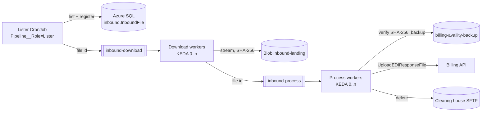
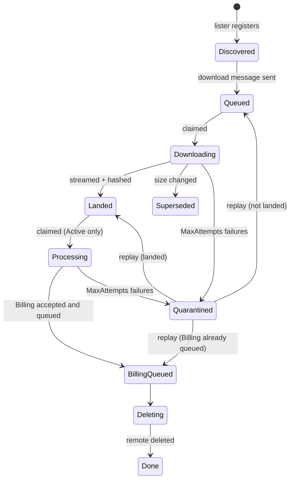

# Inbound queue pipeline

Phase 2 replaces the hourly "download everything in one HTTP request" run with three small workloads that share one image and
one manifest. The legacy endpoint (`POST /ClearingHouseClaimProcessor/downloadEdiDataFromSftp`) is untouched and keeps working
in every mode; the pipeline only runs where an environment opts in.



| Workload | Role | What it does |
| --- | --- | --- |
| `<fullname>` Deployment | `Api` (default) | Legacy endpoint plus the operator endpoints below. |
| `<fullname>-lister` CronJob | `Lister` | Per clearing house: takes the blob lease `leases/inbound-lister-<id>`, lists SFTP, keeps files older than `MinimumFileAgeSeconds`, registers new versions in the manifest, sends one download message per file, and re-sends files stalled for `StalledAfterMinutes`. Exits 0 when every clearing house listed, 1 otherwise. |
| `<fullname>-download` Deployment | `DownloadWorker` | Claims the file, streams it from SFTP into the landing container in 4 MiB blocks while hashing it, and moves it to `Landed`. A size mismatch means the file changed after listing: it becomes `Superseded` and the next listing registers the new version. |
| `<fullname>-process` Deployment | `ProcessWorker` | Claims the landed file, checks its SHA-256, writes the legacy backup, calls Billing exactly as the legacy path does, records `BillingQueuedUtc`, then deletes the remote file (unless `InboundDownload:DeleteRemoteFiles` is false). |

Messages carry only ids (`fileId`, `clearingHouseId`, `attempt`); file names and contents never go on the bus.

## File states



Guarantees:

- **Exactly one owner per step.** Every transition is a compare-and-set on `(Id, State)` in one `UPDATE`. A worker owns an
  in-progress file until `ClaimExpiresUtc` (`ClaimTimeoutMinutes`); a redelivered message can take it over only after that.
- **Billing is called at most once per accepted file.** Once `BillingQueuedUtc` is set, retries and replays only repeat the
  remote delete.
- **What Billing receives is exactly what was downloaded.** The process stage refuses a landed blob whose SHA-256 differs.
- **Retries back off.** A failure schedules the next attempt `RetryBaseDelaySeconds × 2^(attempt-1)` later (capped at
  `RetryMaxDelaySeconds`). After `MaxAttempts` the file is `Quarantined` and the message is dead-lettered with reason `Quarantined`.
  A body that is not a work item is dead-lettered as `InvalidBody`.
- **Crashes recover.** An exception that escapes a handler leaves the message unsettled, so Service Bus redelivers it after
  the lock expires. Files that stay in an unfinished state longer than `StalledAfterMinutes` are re-sent by the next lister run.

Behavior that differs from the legacy run, by design: a file Billing rejects or does not queue is retried with backoff and
then quarantined, instead of waiting for the next hourly run. The outcome (the file stays on SFTP until Billing queues it) is
the same.

## Modes and cutover runbook

`Pipeline:Mode` is read by every role.

| Mode | Lister | Download | Process | Legacy endpoint |
| --- | --- | --- | --- | --- |
| `Off` (default) | logs `1103`, does nothing | — | — | unchanged |
| `Shadow` | lists and enqueues downloads | lands files; sends nothing to processing | not used (a stray message completes with `1106`) | unchanged, still the system of record |
| `Active` | lists and enqueues | lands files | backup, Billing, delete | must be stopped |

1. **Provision** the resources below and run `deployment/sql/inbound-manifest.sql` once per environment.
2. **Shadow.** In `values-<env>.yaml` set `pipeline.enabled: true`, `pipeline.mode: "Shadow"`, the namespace, the manifest
   secret name, and the KEDA identity. Keep the legacy caller running. For a few days compare: every file the legacy run
   processed should appear as `Landed` in the manifest with the same size (`1113` logs vs `1014`). Billing sees nothing new.
3. **Stop the legacy caller** (the scheduler that calls `downloadEdiDataFromSftp`) and scale both worker Deployments to 0.
   Two writers would race for the same SFTP files.
4. **Clear the shadow rows** with `deployment/sql/inbound-manifest-cutover.sql`. The legacy run already sent the shadow files
   to Billing; without this step the Active pipeline would send them again.
5. **Active.** Set `pipeline.mode: "Active"` and deploy. The next lister run registers whatever is still on SFTP.
6. **Roll back** by waiting until `GET /inbound-pipeline/backlog` shows no `Processing`, `BillingQueued`, or `Deleting` files,
   then setting `pipeline.mode: "Off"` and restarting the legacy caller. To return to Active later, repeat steps 3–5.

## Azure resources and access (platform team)

Infrastructure is not created by this repository. Per environment:

| Resource | Settings |
| --- | --- |
| Service Bus namespace (Standard or Premium) | Queues `inbound-download` and `inbound-process`: lock duration 5 min, max delivery count 10, dead-lettering on expiration, default TTL 14 days, duplicate detection off (ids are idempotent through the manifest). Local auth (SAS) disabled. |
| Azure SQL database | Table from `deployment/sql/inbound-manifest.sql`. Entra-only authentication, TDE on, auditing to Log Analytics. |
| Blob container `inbound-landing` | On the backup storage account. Soft delete 7 days, lifecycle rule deleting blobs after 30 days, no public access. Lease blobs live under `leases/`. |
| Key Vault secret `<Env>--Clearinghouse--ConnectionStrings--InboundManifest` | `Server=tcp:<server>.database.windows.net;Database=<db>;Authentication=Active Directory Workload Identity;Encrypt=True;` |
| Kubernetes Secret (optional) | Key `operatorKey`, referenced by `pipeline.operatorKeySecretName`. Without it the operator endpoints answer 404. |

Role assignments for the service's workload identity (`AZURE_CLIENT_ID`):

| Scope | Role |
| --- | --- |
| Both queues | Azure Service Bus Data Sender, Azure Service Bus Data Receiver |
| `inbound-landing` container | Storage Blob Data Contributor (the backup container keeps its existing access) |
| Manifest database | Contained user with `SELECT`, `INSERT`, `UPDATE` on `inbound.InboundFile` (see the script header) |
| Key Vault | Key Vault Secrets User (already granted for the legacy secrets) |

KEDA's identity (`pipeline.workers.kedaIdentityId`) needs **Azure Service Bus Data Owner** on the namespace (KEDA reads
queue runtime properties, which requires Manage).

## HIPAA controls

| Control | How |
| --- | --- |
| Minimum necessary | Queue messages and logs carry ids, file names, sizes, and hashes only. Operator responses omit file names and error text. |
| Encryption in transit | SFTP (optionally host-key pinned), TLS 1.2+ to Service Bus, SQL (`Encrypt=True`), and Blob. |
| Encryption at rest | Storage service encryption on the landing and backup containers, TDE on SQL, Service Bus at-rest encryption. |
| Access control | Entra workload identity everywhere; no SAS or SQL passwords. Operator endpoints need `x-operator-key` (fixed-time compare) and are hidden while the pipeline is off. |
| Integrity | SHA-256 recorded on landing and verified before Billing. |
| Retention | Landing blobs expire by lifecycle rule; the backup container keeps its existing policy. |
| Audit | Every state change logs a stable event id with the file id; SQL auditing and storage diagnostics go to Log Analytics. |

## Monitoring

Pipeline event ids: `1100–1130` application, `2020–2027` infrastructure, `3030–3033` API. Every message scope carries `FileId`
and `PipelineStage`. The queries assume the logging provider writes the event id as `customDimensions.EventId`; if it does not,
filter on the message text of the same events instead.

```kusto
// Quarantined files (alert: any in 15 minutes)
traces
| where timestamp > ago(15m) and customDimensions.EventId == "1121"
| project timestamp, message, customDimensions.FileId, customDimensions.PipelineStage, customDimensions.FailureReason

// Lister run failed or lost its lease (alert: any)
traces
| where timestamp > ago(2h)
| where customDimensions.EventId in ("1104", "2021")
     or (customDimensions.EventId == "3030" and customDimensions.ExitCode != "0")

// Service Bus or dead-letter problems (alert: more than 5 in 15 minutes)
traces
| where timestamp > ago(15m) and customDimensions.EventId in ("2023", "2024")
| summarize count() by tostring(customDimensions.EntityPath)

// Retry pressure per stage
traces
| where timestamp > ago(1h) and customDimensions.EventId == "1120"
| summarize retries = count() by tostring(customDimensions.PipelineStage), bin(timestamp, 5m)

// Follow one file end to end
traces | where customDimensions.FileId == "<file id>" | order by timestamp asc
```

Also alert on Service Bus metrics: dead-lettered messages > 0, and active messages older than 1 hour
(`GET /inbound-pipeline/backlog` returns the same counts from the manifest).

## Operator endpoints

All need header `x-operator-key`. They return 404 while `Pipeline:Mode` is `Off` or no key is configured, and 401 for a wrong key.

| Request | Result |
| --- | --- |
| `GET /inbound-pipeline/backlog` | Files per state and the oldest unfinished file's age. |
| `GET /inbound-pipeline/quarantined?maxCount=50` | Quarantined file ids, clearing house, stage, attempts, and time. |
| `POST /inbound-pipeline/files/{id}/replay` | Requeues a quarantined file from its last safe state: 202, 404 (unknown), 409 (not quarantined). |
| `POST /inbound-pipeline/clearing-houses/{id}/list` | Runs one listing now, outside the CronJob schedule. |

To replay, fix the cause first (Billing outage, SFTP credentials), list quarantined files, and replay each id. The replay resets
`Attempts`; a file whose Billing call already succeeded only repeats the remote delete.
